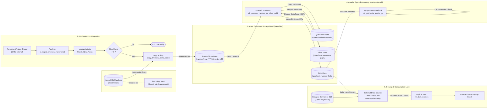
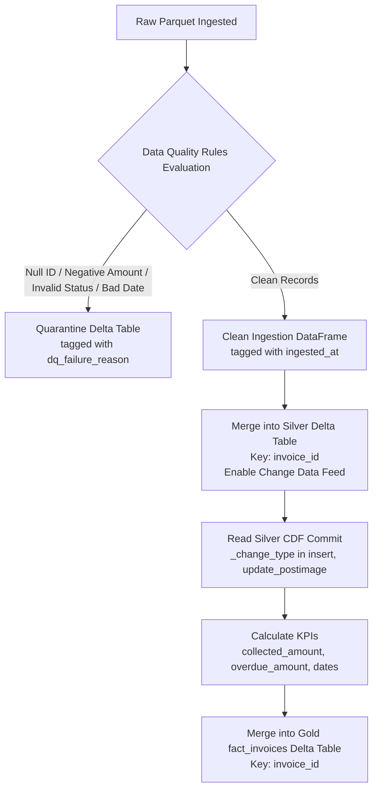
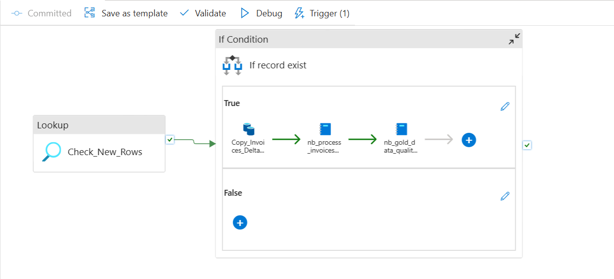
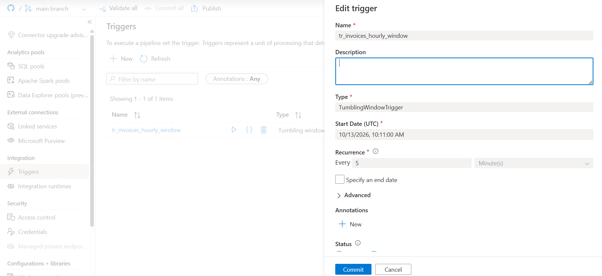
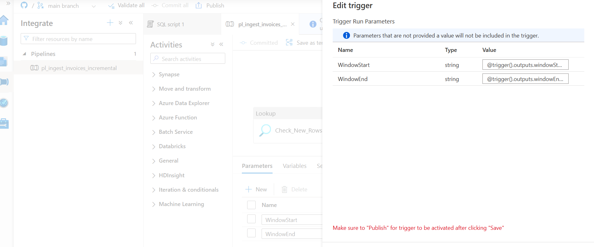
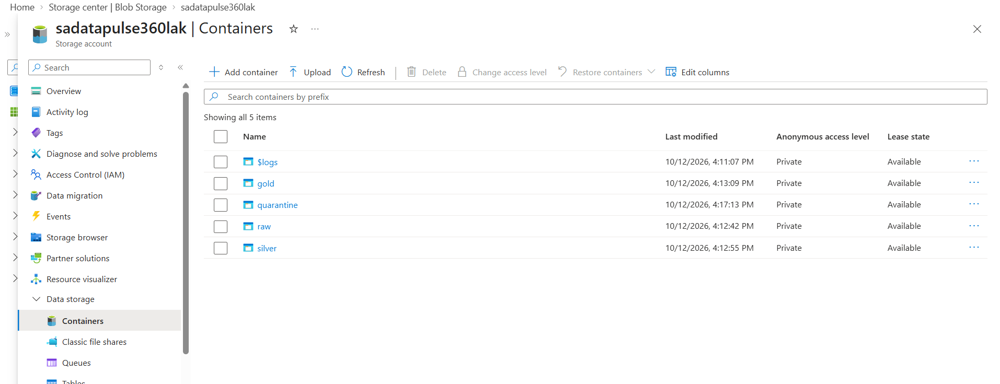
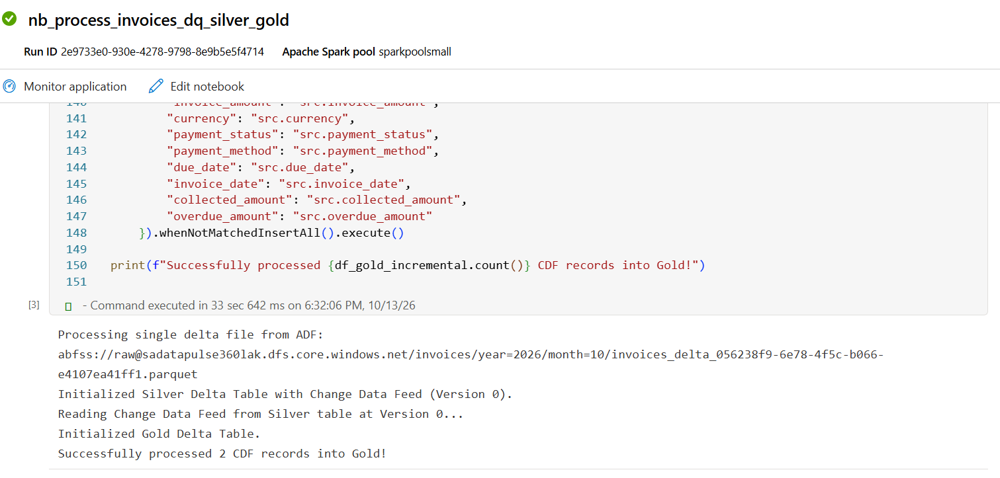
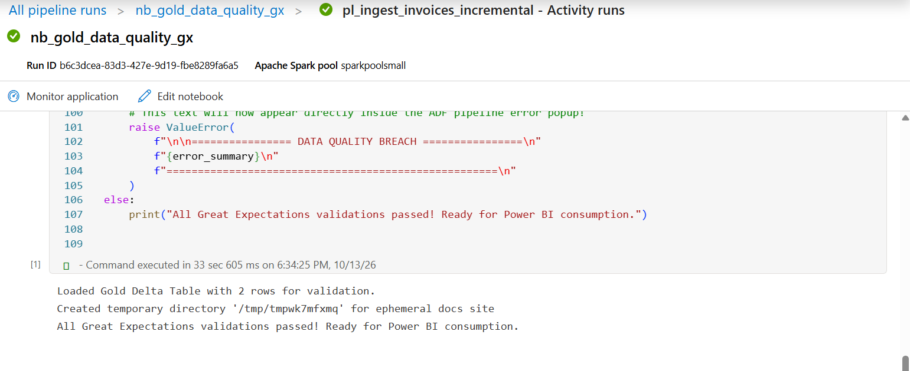
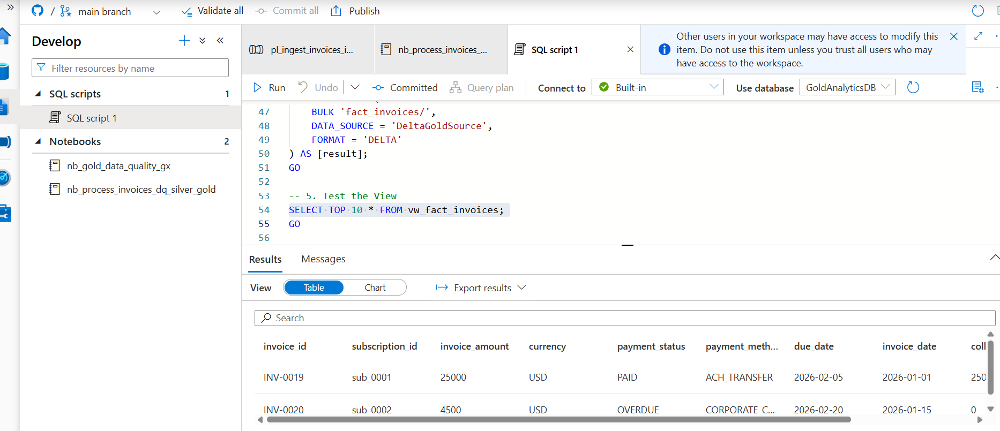
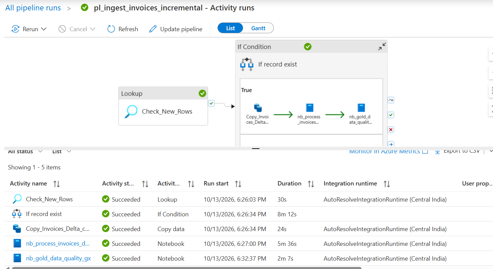

# Azure Synapse Analytics - Incremental Ingestion, Medallion Lakehouse & Data Quality POC

[](https://azure.microsoft.com/en-us/products/synapse-analytics/)
[](https://spark.apache.org/)
[](https://delta.io/)
[](https://greatexpectations.io/)
[](https://azure.microsoft.com/en-us/products/storage/data-lake-storage/)
[](https://learn.microsoft.com/en-us/azure/synapse-analytics/sql/on-demand-workspace-overview)

---

## Table of Contents
1. [Introduction](#1-introduction)
2. [Problem Statement](#2-problem-statement)
3. [Proposed Solution](#3-proposed-solution)
4. [High-Level Architecture](#4-high-level-architecture)
   - [Architecture Workflow](#architecture-workflow)
   - [Architectural Components](#architectural-components)
   - [Architecture Diagram Placeholder](#architecture-diagram-placeholder)
5. [Repository Structure](#5-repository-structure)
6. [Core Pipeline & Lakehouse Components](#6-core-pipeline--lakehouse-components)
   - [Incremental Ingestion Pipeline (`pl_ingest_invoices_incremental`)](#incremental-ingestion-pipeline-pl_ingest_invoices_incremental)
   - [Tumbling Window Trigger (`tr_invoices_hourly_window`)](#tumbling-window-trigger-tr_invoices_hourly_window)
   - [Medallion Architecture & Quarantine Pattern (`nb_process_invoices_dq_silver_gold`)](#medallion-architecture--quarantine-pattern-nb_process_invoices_dq_silver_gold)
   - [Delta Change Data Feed (CDF) Propagation](#delta-change-data-feed-cdf-propagation)
   - [Great Expectations Circuit Breaker (`nb_gold_data_quality_gx`)](#great-expectations-circuit-breaker-nb_gold_data_quality_gx)
   - [Serverless SQL Analytics (`GoldAnalyticsDB`)](#serverless-sql-analytics-goldanalyticsdb)
7. [Prerequisites](#7-prerequisites)
   - [Azure Resources & Infrastructure](#azure-resources--infrastructure)
   - [Role-Based Access Control (RBAC) & Permissions](#role-based-access-control-rbac--permissions)
   - [Spark Environment & Dependencies](#spark-environment--dependencies)
8. [Setup & Deployment Guide](#8-setup--deployment-guide)
   - [Step 1: ADLS Gen2 Storage Setup](#step-1-adls-gen2-storage-setup)
   - [Step 2: Azure Key Vault & Secret Storage](#step-2-azure-key-vault--secret-storage)
   - [Step 3: Source Azure SQL Database Setup](#step-3-source-azure-sql-database-setup)
   - [Step 4: Linked Services & Datasets Configuration](#step-4-linked-services--datasets-configuration)
   - [Step 5: Synapse Spark Pool Configuration](#step-5-synapse-spark-pool-configuration)
   - [Step 6: Deploy Notebooks & Pipeline](#step-6-deploy-notebooks--pipeline)
   - [Step 7: Serverless SQL Views Initialization](#step-7-serverless-sql-views-initialization)
9. [Execution & Operational Guide](#9-execution--operational-guide)
   - [Execution Mode 1: Manual Pipeline Run](#execution-mode-1-manual-pipeline-run)
   - [Execution Mode 2: Automated Tumbling Window Trigger](#execution-mode-2-automated-tumbling-window-trigger)
   - [Monitoring & Troubleshooting](#monitoring--troubleshooting)
   - [Testing & Validation Scenarios](#testing--validation-scenarios)
10. [Visual Artifacts & Image Placeholders](#10-visual-artifacts--image-placeholders)
11. [Best Practices & Future Enhancements](#11-best-practices--future-enhancements)

---

## 1. Introduction

The **Azure Synapse Analytics Ingestion & Quality POC** demonstrates an enterprise-grade, end-to-end modern data lakehouse pattern built on **Microsoft Azure**. The project ingests transactional subscription invoice data from an operational **Azure SQL Database** incrementally, stages it in **Azure Data Lake Storage Gen2 (ADLS Gen2)**, and processes it through a multi-tier **Medallion Architecture (Bronze / Silver / Gold)** powered by **Apache Spark (PySpark)** and **Delta Lake**.

### Key Highlights
- **Incremental Micro-Batching:** Ingestion driven by high-performance SQL watermarking and Synapse Tumbling Window Triggers.
- **Cost-Optimized Orchestration:** Zero-record bypass checks prevent wasteful Spark cluster executions when no delta changes occur.
- **Data Quarantine Pattern:** Bad/corrupt records are automatically segregated into an isolated Delta quarantine container without halting batch processing.
- **Change Data Feed (CDF):** Downstream Gold aggregates are hydrated strictly from Silver transaction commits via Delta CDF, avoiding full-table scans.
- **Automated Data Quality Circuit Breaker:** Enterprise-grade validation suite using **Great Expectations (GX)** stops corrupt data from reaching reporting layers by actively failing the pipeline upon threshold breach.
- **Zero-Copy Serving Layer:** **Synapse Serverless SQL Pools** virtualize the Gold Delta Lake into standard T-SQL views for direct consumption by Power BI,  reporting analysts.

---

## 2. Problem Statement

Modern enterprise billing and subscription platforms produce high volumes of transactional invoice records across continuous business operations. Organizations commonly encounter the following operational bottlenecks:

1. **OLTP Production Resource Contention:** Running heavy analytical queries or full-table ETL extracts against active production databases causes table locks, thread exhaustion, and latency spikes for end-users.
2. **Expensive & Inefficient Full Refreshes:** Re-extracting, copying, and calculating aggregations across millions of historical invoice records for every ETL cycle wastes network bandwidth, storage, and Spark compute capacity.
3. **Silent Downstream Data Corruption:** Invoices with null IDs, inverted billing cycles (`billing_period_end < billing_period_start`), negative billing figures, or unexpected payment statuses silently enter reporting data marts, skewing corporate financial figures.
4. **Lack of Ingestion Quarantine Mechanism:** Most ETL pipelines either fail completely upon encountering a single invalid row (blocking business operations) or ignore corrupt rows entirely without auditability.
5. **Decoupled Data Quality Validations:** Data quality tests are frequently run as detached post-hoc reports rather than active, blocking gates within the continuous deployment and pipeline execution cycle.
6. **Data Duplication in Serving Warehouses:** Organizations often ingest data into a lake and then duplicate the full dataset into an expensive dedicated SQL warehouse, driving up compute licensing and infrastructure costs.

---

## 3. Proposed Solution

This POC implements a resilient, event-aware, serverless lakehouse pattern that directly addresses each problem statement:

| Challenge | Implemented Solution | Architecture Layer |
| :--- | :--- | :--- |
| **Database Contention** | Non-blocking dirty reads (`WITH (NOLOCK)`) scoped to strict incremental time windows (`[WindowStart, WindowEnd)`). | Ingestion (Synapse Pipeline) |
| **Compute Cost & Run Time** | Lightweight `Lookup` activity counts delta rows before launching Spark; pipeline short-circuits if row count is 0. | Orchestration (IfCondition) |
| **Data Landing** | Micro-batch raw landing as Snappy-compressed Parquet partitioned by `year=YYYY/month=MM/invoices_delta_{RunId}.parquet`. | Storage (Bronze / Raw ADLS) |
| **Corrupted Data Ingestion** | **Quarantine Pattern:** Bad rows are tagged with failure codes (`FAIL_NEGATIVE_AMOUNT`, `FAIL_INVALID_DATE_RANGE`, etc.) and diverted to a quarantine Delta table. | Processing (PySpark & Delta) |
| **Historical Duplication** | Silver layer leverages Delta Lake `MERGE` with **Change Data Feed (CDF)** enabled to track only row-level delta mutations. | Storage (Silver Delta Lake) |
| **Incremental Gold Aggregations** | Gold reads *strictly* `insert` and `update_postimage` rows produced in that specific commit version via `readChangeFeed`. | Storage (Gold Fact Invoices) |
| **Silent Data Breaches** | **Great Expectations Circuit Breaker:** Runs 7 assertions on the Gold table; immediately raises a pipeline-terminating `ValueError` on failure. | Quality Gate (PySpark GX Suite) |
| **Redundant Storage & Warehouse Costs** | Synapse Serverless SQL exposes Gold Delta Lake as logical SQL views (`vw_fact_invoices`) using `OPENROWSET(FORMAT='DELTA')`. | Analytics / Serving Layer |

---

## 4. High-Level Architecture

### Architecture Workflow



### Architectural Components

1. **Source Tier:**
   - **Azure SQL Database (`datapulse360_db`):** Source OLTP database holding the billing transactions table `dbo.invoices`.
   - **Azure Key Vault (`data-ai-sql-db-password`):** Secret vault storing the SQL database connection credentials securely.
2. **Orchestration Tier:**
   - **Azure Synapse Pipeline (`pl_ingest_invoices_incremental`):** Orchestrator executing the lookup check, data extract, and sequential Spark notebooks.
   - **Tumbling Window Trigger (`tr_invoices_hourly_window`):** Triggers pipeline runs periodically passing historical start/end time windows for zero data loss.
3. **Data Lake Storage Gen2 (`sadatapulse360lak`):**
   - `raw`: Staging zone holding raw delta Parquet files partitioned by year and month.
   - `quarantine`: Delta Lake holding quarantined records tagged with `dq_failure_reason` and `quarantined_at`.
   - `silver`: Curated Delta Lake table with history tracking and Change Data Feed enabled.
   - `gold`: Aggregated business-ready analytical Delta Lake table containing dimensions and calculated financial KPIs.
4. **Compute Tier:**
   - **Synapse Apache Spark Pool (`sparkpoolsmall`):** Spark 3.5 runtime with Delta Lake and Great Expectations executing scalable data transformations.
5. **Consumption Tier:**
   - **Serverless SQL Pool (`Built-in`):** On-demand T-SQL engine virtualizing Gold Delta Lake through database `GoldAnalyticsDB`. Secured with a **Database Master Key**, **Database Scoped Credential (`WorkspaceIdentity`)** using Synapse Workspace Managed Identity, an **External Data Source (`DeltaGoldSource`)**, and the analytical view `vw_fact_invoices`.
   - **BI & Analytics:** Power BI, Tableau, Azure Fabric, or Excel consuming the logical views with low latency.

---


## 5. Repository Structure

This repository follows the official Azure Synapse Git integration format:

```text
azure-synapse-poc/
├── README.md                                      # Comprehensive project documentation (this file)
├── images/                                        # Directory for architectural & UI screenshots
│   └── .gitkeep
└── synapse/                                       # Root of Azure Synapse workspace artifacts
    ├── publish_config.json                        # Synapse Git publish configuration
    ├── credential/
    │   └── WorkspaceSystemIdentity.json           # Synapse Managed Identity credential
    ├── integrationRuntime/
    │   └── AutoResolveIntegrationRuntime.json     # Built-in Azure Integration Runtime
    ├── linkedService/
    │   ├── dataaisynapse-WorkspaceDefaultSqlServer.json # Synapse workspace dedicated SQL endpoint
    │   ├── dataaisynapse-WorkspaceDefaultStorage.json   # Primary workspace ADLS Gen2 filesystem
    │   ├── datapulse360dl.json                     # ADLS Gen2 linked service for sadatapulse360lak
    │   ├── ls_azuresql_source.json                 # Azure SQL DB linked service using AKV secret
    │   └── ls_keyvault.json                        # Azure Key Vault linked service
    ├── dataset/
    │   ├── AzureSqlTable1.json                     # Source dataset for dbo.invoices in Azure SQL
    │   └── Parquet1.json                           # Target raw Parquet dataset with dynamic pathing
    ├── pipeline/
    │   └── pl_ingest_invoices_incremental.json     # Master incremental ingestion & orchestration pipeline
    ├── notebook/
    │   ├── nb_process_invoices_dq_silver_gold.json # PySpark notebook for DQ, Quarantine, Silver, & Gold
    │   └── nb_gold_data_quality_gx.json            # PySpark notebook for Great Expectations circuit breaker
    ├── trigger/
    │   └── tr_invoices_hourly_window.json          # Tumbling window trigger for automated incremental runs
    └── sqlscript/
        └── SQL script 1.json                       # Serverless SQL script creating GoldAnalyticsDB & view
```

---

## 6. Core Pipeline & Lakehouse Components

### Incremental Ingestion Pipeline (`pl_ingest_invoices_incremental`)

The pipeline implements an efficient watermark-based micro-batch extraction pattern parameterized by `WindowStart` and `WindowEnd`:

1. **Activity: `Check_New_Rows` (Lookup Activity)**
   - Queries source Azure SQL Database:
     ```sql
     SELECT COUNT(1) AS total_rows 
     FROM invoices WITH (NOLOCK) 
     WHERE updated_at >= '@{pipeline().parameters.WindowStart}' 
       AND updated_at < '@{pipeline().parameters.WindowEnd}'
     ```
   - Avoids spinning up downstream jobs or copying empty payloads when source data has not changed.

2. **Activity: `If record exist` (IfCondition Activity)**
   - Evaluates expression:
     ```json
     @greater(activity('Check_New_Rows').output.firstRow.total_rows, 0)
     ```
   - **True Path:** Triggers Copy Data activity followed by Spark notebooks.
   - **False Path:** Pipeline completes in seconds with zero compute waste.

3. **Activity: `Copy_Invoices_Delta_copy1` (Copy Data Activity)**
   - Extracts rows modified within the window using non-blocking dirty read (`WITH (NOLOCK)`).
   - Writes to ADLS Gen2 `raw` container as Snappy-compressed Parquet.
   - Dynamic landing path:
     ```text
     invoices/year=@{formatDateTime(pipeline().TriggerTime, 'yyyy')}/month=@{formatDateTime(pipeline().TriggerTime, 'MM')}/invoices_delta_@{pipeline().RunId}.parquet
     ```

4. **Activity: `nb_process_invoices_dq_silver_gold_copy1` (Synapse Notebook Activity)**
   - Passes the exact Parquet target file path into the notebook parameter cell:
     ```text
     abfss://raw@sadatapulse360lak.dfs.core.windows.net/invoices/year=YYYY/month=MM/invoices_delta_{RunId}.parquet
     ```

5. **Activity: `nb_gold_data_quality_gx` (Synapse Notebook Activity)**
   - Executes after successful completion of the Silver/Gold transformation.
   - Validates the Gold layer against 7 business and integrity assertions.

---

### Tumbling Window Trigger (`tr_invoices_hourly_window`)

The pipeline is triggered using an Azure Synapse **Tumbling Window Trigger**:
- **Frequency & Interval:** Configured to run every **5 minutes(for testing only, idealy it should be as per requirement like 24 hours or every 6 hours)**.
- **Self-Healing Windows:** Tumbling windows are contiguous, non-overlapping time slices. If a run fails or the pipeline is temporarily stopped, Synapse automatically backfills missing slices in chronological sequence.
- **Parameters Passed:**
  - `WindowStart`: `@trigger().outputs.windowStartTime`
  - `WindowEnd`: `@trigger().outputs.windowEndTime`
- **Concurrency & Retry:** `maxConcurrency: 50`, `retryPolicy: intervalInSeconds: 30`.

---

### Medallion Architecture & Quarantine Pattern (`nb_process_invoices_dq_silver_gold`)

The notebook `nb_process_invoices_dq_silver_gold` implements data refinement across the lakehouse:



#### 1. Data Quality Engine & Quarantine Rules
Every incoming record is evaluated through strict business logic:
```python
VALID_STATUSES = ['PAID', 'PENDING', 'OVERDUE', 'REFUNDED']

df_validated = df_bronze.withColumn(
    "dq_failure_reason",
    when(col("invoice_id").isNull(), "FAIL_NULL_INVOICE_ID")
    .when(col("invoice_amount") < 0, "FAIL_NEGATIVE_AMOUNT")
    .when(~col("payment_status").isin(VALID_STATUSES), "FAIL_INVALID_STATUS")
    .when(col("billing_period_end") < col("billing_period_start"), "FAIL_INVALID_DATE_RANGE")
    .otherwise("PASS")
)
```
- **Quarantine Storage:** Records failing any check are enriched with a timestamp `quarantined_at` and appended to:
  `abfss://quarantine@sadatapulse360lak.dfs.core.windows.net/invoices`
- **Clean Storage:** Records passing all checks are stamped with `ingested_at` and passed to Silver.

#### 2. Silver Layer Upsert
The clean records are merged into the Silver Delta table on primary key `invoice_id`. If matching, row attributes are updated; if new, inserted:
```python
silver_table.alias("tgt").merge(
    df_silver_clean.alias("src"),
    "tgt.invoice_id = src.invoice_id"
).whenMatchedUpdate(set={...}).whenNotMatchedInsertAll().execute()
```

---

### Delta Change Data Feed (CDF) Propagation

To eliminate the need for costly full-table scans when building downstream analytics, **Delta Change Data Feed (CDF)** is enabled on the Silver table:
```sql
ALTER TABLE delta.`abfss://silver@sadatapulse360lak.dfs.core.windows.net/invoices` 
SET TBLPROPERTIES (delta.enableChangeDataFeed = true)
```

The notebook captures the specific version generated by the Silver merge:
```python
current_version = silver_table.history(1).select("version").collect()[0]["version"]

df_silver_cdf = spark.read.format("delta") \
    .option("readChangeFeed", "true") \
    .option("startingVersion", current_version) \
    .option("endingVersion", current_version) \
    .load(SILVER_PATH)
```

By filtering for `_change_type` in `('insert', 'update_postimage')`, the pipeline extracts only net changes and computes business metrics for Gold:
- **`collected_amount`:** Set to `invoice_amount` if `payment_status == 'PAID'`, else `0.0`.
- **`overdue_amount`:** Set to `invoice_amount` if `payment_status == 'OVERDUE'`, else `0.0`.
- **`invoice_date`:** Derived from `billing_period_start`.
- **`due_date`:** Standardized date format.

The transformed delta is merged into `abfss://gold@sadatapulse360lak.dfs.core.windows.net/fact_invoices`.

---

### Great Expectations Circuit Breaker (`nb_gold_data_quality_gx`)

Before exposing the newly processed Gold data to business stakeholders, the pipeline executes `nb_gold_data_quality_gx` using **Great Expectations (GX)** in ephemeral mode.

#### 7 Enterprise Quality Assertions
1. **Row Count Check:** Table must have at least 1 record (`ExpectTableRowCountToBeBetween(min_value=1)`).
2. **PK Non-Null Integrity:** `invoice_id` must never be null (`ExpectColumnValuesToNotBeNull(column="invoice_id")`).
3. **PK Uniqueness:** `invoice_id` must have 0 duplicates (`ExpectColumnValuesToBeUnique(column="invoice_id")`).
4. **Positive Invoicing:** `invoice_amount` must be >= 0 (`ExpectColumnValuesToBeBetween(column="invoice_amount", min_value=0.0)`).
5. **Payment Status Domain:** `payment_status` must strictly equal `PAID`, `PENDING`, `OVERDUE`, or `REFUNDED` (`ExpectColumnValuesToBeInSet(...)`).
6. **Currency Domain:** `currency` must strictly belong to standard ISO codes (`USD`, `EUR`, `GBP`, `INR`, `CAD`).
7. **Temporal Chronology:** `due_date >= invoice_date` (`ExpectColumnPairValuesAToBeGreaterThanB(..., or_equal=True)`).

#### Active Circuit Breaker Behavior
If any expectation fails, the notebook extracts the failure details and raises a descriptive `ValueError`:
```python
if not validation_results.success:
    raise ValueError(
        f"\n\n================ DATA QUALITY BREACH ================\n"
        f"{error_summary}\n"
        f"=====================================================\n"
    )
```
This forces the Azure Synapse Pipeline activity to fail with an explicit diagnostic message in the Synapse Monitor UI, protecting business reports from corrupted numbers.

---

### Serverless SQL Analytics (`GoldAnalyticsDB`)

The Gold layer is published without data duplication using Azure Synapse Serverless SQL Pools (`Built-in`). The solution implements an enterprise-grade security pattern using **Database Master Key**, **Database Scoped Credentials (Workspace Managed Identity)**, and an **External Data Source**:

- **Database:** `GoldAnalyticsDB`
- **Credential:** `WorkspaceIdentity` (Managed Identity authentication)
- **External Data Source:** `DeltaGoldSource` (`https://sadatapulse360lak.dfs.core.windows.net/gold`)
- **Logical View:** `vw_fact_invoices`

#### Implementation Script (`SQL script 1.json`):
```sql
USE GoldAnalyticsDB;
GO

-- 1. Create Master Key if it doesn't already exist
IF NOT EXISTS (SELECT * FROM sys.symmetric_keys WHERE name LIKE '%DatabaseMasterKey%')
BEGIN
    CREATE MASTER KEY ENCRYPTION BY PASSWORD = 'P@ssw0rdMasterKey123!';
END
GO

-- 2. Create Database Scoped Credential using Synapse Managed Identity
IF NOT EXISTS (SELECT * FROM sys.database_scoped_credentials WHERE name = 'WorkspaceIdentity')
BEGIN
    CREATE DATABASE SCOPED CREDENTIAL WorkspaceIdentity
    WITH IDENTITY = 'Managed Identity';
END
GO

-- 3. Create External Data Source pointing to the 'gold' container
IF EXISTS (SELECT * FROM sys.external_data_sources WHERE name = 'DeltaGoldSource')
BEGIN
    DROP EXTERNAL DATA SOURCE DeltaGoldSource;
END
GO

CREATE EXTERNAL DATA SOURCE DeltaGoldSource
WITH (
    LOCATION = 'https://sadatapulse360lak.dfs.core.windows.net/gold',
    CREDENTIAL = WorkspaceIdentity
);
GO

-- 4. Re-create the View using the External Data Source
CREATE OR ALTER VIEW vw_fact_invoices AS
SELECT 
    invoice_id,
    subscription_id,
    invoice_amount,
    currency,
    payment_status,
    payment_method,
    due_date,
    invoice_date,
    collected_amount,
    overdue_amount
FROM OPENROWSET(
    BULK 'fact_invoices/',
    DATA_SOURCE = 'DeltaGoldSource',
    FORMAT = 'DELTA'
) AS [result];
GO

-- 5. Test the View
SELECT TOP 10 * FROM vw_fact_invoices;
GO
```

#### Key Architecture Advantages of this Approach:
1. **Zero Secret Hardcoding:** Authenticates using Azure Synapse Workspace Managed Identity (`WorkspaceIdentity`) rather than SAS tokens or access keys.
2. **Abstracted Data Source (`DeltaGoldSource`):** Query writers and views do not require hardcoded ADLS storage URLs; file paths are decoupled from physical storage endpoints.
3. **Defense-in-Depth:** Encrypted via the Database Master Key, adhering to enterprise Azure security baselines.
4. **Zero-Copy Serving:** BI tools query Delta Lake files directly with sub-second response times without loading data into dedicated warehouse tables.

Analysts and BI tools can query this view with standard analytical T-SQL:
```sql
SELECT 
    payment_status,
    COUNT(*) AS invoice_count,
    SUM(invoice_amount) AS total_billed,
    SUM(collected_amount) AS total_collected,
    SUM(overdue_amount) AS total_overdue
FROM vw_fact_invoices
GROUP BY payment_status;
```

---

## 7. Prerequisites

### Azure Resources & Infrastructure

| Resource | Identifier / Name in POC                   | Description / Purpose |
| :--- |:-------------------------------------------| :--- |
| **Azure Subscription** | `[suspcription]`                           | Host cloud subscription. |
| **Resource Group** | `[Resource group name]`                    | Logical resource container. |
| **Synapse Workspace** | `dataaisynapse`                            | Unified analytics workspace. |
| **Apache Spark Pool** | `sparkpoolsmall`                           | Spark 3.5 pool (3 nodes, 4 vCores, 28GB RAM). |
| **Serverless SQL Pool** | `Built-in`                                 | On-demand query engine. |
| **Storage Account** | `sadatapulse360lak`                        | ADLS Gen2 Hierarchical Namespace enabled storage. |
| **Azure SQL Database** | `sql-datapulse360-srv` / `datapulse360_db` | Source OLTP relational database. |
| **Azure Key Vault** | `data-ai-sql-db-password`                  | Secret management for credentials. |

### Role-Based Access Control (RBAC) & Permissions

Assign the following permissions to ensure seamless communication:
1. **Synapse Managed Identity (`dataaisynapse`):**
   - **Storage Blob Data Contributor** on ADLS Gen2 storage account `sadatapulse360lak`.
   - **Key Vault Secrets User** on Key Vault `data-ai-sql-db-password`.
2. **Azure SQL Database:**
   - Database user for `dataaiadmin` with `db_datareader` or specific `SELECT` privileges on `dbo.invoices`.
3. **Data Engineer / User:**
   - **Synapse Administrator** or **Synapse Contributor** on the Synapse workspace.
   - **Storage Blob Data Contributor** on `sadatapulse360lak`.

### Spark Environment & Dependencies

Ensure the following packages are present in the Synapse Apache Spark 3.5 pool:
- `great-expectations` (v0.18+ or v1.0+)
- `delta-spark` (compatible with Spark 3.5)

---

## 8. Setup & Deployment Guide

### Step 1: ADLS Gen2 Storage Setup

1. In the Azure Portal, open the storage account `sadatapulse360lak`.
2. Navigate to **Containers** under **Data storage**.
3. Create the four medallion containers:
   - `raw`
   - `quarantine`
   - `silver`
   - `gold`

---

### Step 2: Azure Key Vault & Secret Storage

1. Open Azure Key Vault `data-ai-sql-db-password`.
2. Under **Objects > Secrets**, select **Generate/Import**.
3. Create secret:
   - **Name:** `sql-db-password`
   - **Secret Value:** *(Enter the password for SQL user `dataaiadmin`)*
4. Ensure the Synapse workspace Managed Identity has **Key Vault Secrets User** assigned.

---

### Step 3: Source Azure SQL Database Setup

1. Connect to Azure SQL Database `sql-datapulse360-srv.database.windows.net` / `datapulse360_db` using SSMS or Azure Data Studio.
2. Execute the table DDL to create `dbo.invoices`:

```sql
CREATE TABLE dbo.invoices (
    invoice_id VARCHAR(50) NOT NULL PRIMARY KEY,
    subscription_id VARCHAR(50) NOT NULL,
    invoice_amount DECIMAL(12, 2) NOT NULL,
    currency VARCHAR(10) NOT NULL,
    billing_period_start DATE NOT NULL,
    billing_period_end DATE NOT NULL,
    due_date DATE NOT NULL,
    payment_status VARCHAR(20) NOT NULL,
    payment_method VARCHAR(50) NOT NULL,
    created_at DATETIME2(7) DEFAULT SYSUTCDATETIME(),
    updated_at DATETIME2(7) DEFAULT SYSUTCDATETIME()
);

-- Recommended index for incremental watermark queries
CREATE NONCLUSTERED INDEX IX_invoices_updated_at 
ON dbo.invoices (updated_at) 
INCLUDE (invoice_id, invoice_amount, payment_status);
```

3. Populate initial seed test data:

```sql
INSERT INTO dbo.invoices (
    invoice_id, subscription_id, invoice_amount, currency,
    billing_period_start, billing_period_end, due_date,
    payment_status, payment_method, created_at, updated_at
)
VALUES
('INV-1001', 'SUB-01', 150.00, 'USD', '2026-10-01', '2026-10-31', '2026-11-15', 'PAID', 'CREDIT_CARD', SYSUTCDATETIME(), SYSUTCDATETIME()),
('INV-1002', 'SUB-02', 450.50, 'EUR', '2026-10-01', '2026-10-31', '2026-11-15', 'PENDING', 'BANK_TRANSFER', SYSUTCDATETIME(), SYSUTCDATETIME()),
('INV-1003', 'SUB-03', 89.99, 'USD', '2026-10-01', '2026-10-31', '2026-11-15', 'OVERDUE', 'CREDIT_CARD', SYSUTCDATETIME(), SYSUTCDATETIME());
```

---

### Step 4: Linked Services & Datasets Configuration

In Synapse Studio, verify or import the JSON definitions located in [`synapse/linkedService/`](synapse/linkedService/):
- [`ls_keyvault.json`](synapse/linkedService/ls_keyvault.json): Points to `https://data-ai-sql-db-password.vault.azure.net/`.
- [`ls_azuresql_source.json`](synapse/linkedService/ls_azuresql_source.json): Points to `sql-datapulse360-srv.database.windows.net`, references `ls_keyvault` secret `sql-db-password`.
- [`datapulse360dl.json`](synapse/linkedService/datapulse360dl.json): Points to `https://sadatapulse360lak.dfs.core.windows.net/` using Managed Identity.

Import the datasets from [`synapse/dataset/`](synapse/dataset/):
- [`AzureSqlTable1.json`](synapse/dataset/AzureSqlTable1.json): Maps to `dbo.invoices`.
- [`Parquet1.json`](synapse/dataset/Parquet1.json): Maps to ADLS Gen2 `raw` filesystem with parameterized path.

---

### Step 5: Synapse Spark Pool Configuration

1. In Synapse Studio, navigate to **Manage > Apache Spark pools**.
2. Verify or create pool `sparkpoolsmall`:
   - **Node size:** Small (4 vCPU / 28 GB RAM)
   - **Autoscale:** Disabled (or 3-3 nodes)
   - **Spark version:** 3.5
3. Under **Packages**, upload a `requirements.txt` file containing:
   ```text
   great-expectations>=0.18.0
   ```
4. Save and allow the pool library installation to complete.

---

### Step 6: Deploy Notebooks & Pipeline

1. Under **Develop > Notebooks**, import:
   - [`nb_process_invoices_dq_silver_gold.json`](synapse/notebook/nb_process_invoices_dq_silver_gold.json)
   - [`nb_gold_data_quality_gx.json`](synapse/notebook/nb_gold_data_quality_gx.json)
2. Attach both notebooks to `sparkpoolsmall`.
3. Under **Integrate > Pipelines**, import:
   - [`pl_ingest_invoices_incremental.json`](synapse/pipeline/pl_ingest_invoices_incremental.json)
4. Under **Manage > Triggers**, import:
   - [`tr_invoices_hourly_window.json`](synapse/trigger/tr_invoices_hourly_window.json)
5. Select **Publish all** to commit all changes to the Synapse workspace.

---

### Step 7: Serverless SQL Views Initialization

1. In Synapse Studio, open **Develop > SQL scripts**.
2. Connect to the **Built-in** Serverless SQL pool.
3. If database `GoldAnalyticsDB` does not exist, create it:
   ```sql
   CREATE DATABASE GoldAnalyticsDB;
   GO
   ```
4. Execute the complete script from [`SQL script 1.json`](synapse/sqlscript/SQL%20script%201.json) to configure encryption, Managed Identity credentials, the External Data Source, and the virtual view:

```sql
USE GoldAnalyticsDB;
GO

-- 1. Create Master Key if it doesn't already exist
IF NOT EXISTS (SELECT * FROM sys.symmetric_keys WHERE name LIKE '%DatabaseMasterKey%')
BEGIN
    CREATE MASTER KEY ENCRYPTION BY PASSWORD = 'P@ssw0rdMasterKey123!';
END
GO

-- 2. Create Database Scoped Credential using Synapse Managed Identity
IF NOT EXISTS (SELECT * FROM sys.database_scoped_credentials WHERE name = 'WorkspaceIdentity')
BEGIN
    CREATE DATABASE SCOPED CREDENTIAL WorkspaceIdentity
    WITH IDENTITY = 'Managed Identity';
END
GO

-- 3. Create External Data Source pointing to the 'gold' container
IF EXISTS (SELECT * FROM sys.external_data_sources WHERE name = 'DeltaGoldSource')
BEGIN
    DROP EXTERNAL DATA SOURCE DeltaGoldSource;
END
GO

CREATE EXTERNAL DATA SOURCE DeltaGoldSource
WITH (
    LOCATION = 'https://sadatapulse360lak.dfs.core.windows.net/gold',
    CREDENTIAL = WorkspaceIdentity
);
GO

-- 4. Re-create the View using the External Data Source
CREATE OR ALTER VIEW vw_fact_invoices AS
SELECT 
    invoice_id,
    subscription_id,
    invoice_amount,
    currency,
    payment_status,
    payment_method,
    due_date,
    invoice_date,
    collected_amount,
    overdue_amount
FROM OPENROWSET(
    BULK 'fact_invoices/',
    DATA_SOURCE = 'DeltaGoldSource',
    FORMAT = 'DELTA'
) AS [result];
GO

-- 5. Test the View
SELECT TOP 10 * FROM vw_fact_invoices;
GO
```

---

## 9. Execution & Operational Guide

### Execution Mode 1: Manual Pipeline Run

To test or backfill data manually:
1. In Synapse Studio, open pipeline [`pl_ingest_invoices_incremental`](synapse/pipeline/pl_ingest_invoices_incremental.json).
2. Click **Debug** or **Add Trigger > Trigger now**.
3. Supply parameters:
   - `WindowStart`: `2026-10-01 00:00:00`
   - `WindowEnd`: `2026-10-15 00:00:00`
4. Monitor execution under the **Output** tab.

---

### Execution Mode 2: Automated Tumbling Window Trigger

To activate scheduled execution:
1. In Synapse Studio, navigate to **Manage > Triggers**.
2. Find trigger `tr_invoices_hourly_window`.
3. Toggle state from **Stopped** to **Started**.
4. Select **Publish all**.
5. The trigger will continuously schedule runs in 5-minute increments.

---

### Monitoring & Troubleshooting

1. **Pipeline Runs:** Navigate to **Monitor > Pipeline runs**. Inspect activity durations and input/output JSON payloads.
2. **Spark Applications:** Navigate to **Monitor > Apache Spark applications** to view executor logs, DAGs, and Spark driver console logs.
3. **Quarantine Inspection:** To check rows quarantined during pipeline execution, query the quarantine container in Serverless SQL or Spark:
   ```sql
   SELECT * FROM OPENROWSET(
       BULK 'https://sadatapulse360lak.dfs.core.windows.net/quarantine/invoices/',
       FORMAT = 'DELTA'
   ) AS [bad_records];
   ```

---

### Testing & Validation Scenarios

#### Scenario A: Happy Path (Clean Ingestion & Upsert)
- **Action:** Insert 10 clean invoice records in Azure SQL DB.
- **Expected Result:**
  - `Check_New_Rows` detects 10 rows.
  - Parquet file is saved in `raw/invoices/year=YYYY/month=MM/`.
  - Silver Delta table is updated via `MERGE`.
  - Gold Delta table receives new/updated records via CDF.
  - Great Expectations passes all 7 assertions.
  - View `vw_fact_invoices` immediately reflects 10 new rows.

#### Scenario B: Quarantine Handling (Corrupted Records Diverted)
- **Action:** Insert a record with `invoice_amount = -50.00` and another with `payment_status = 'UNKNOWN'`.
- **Expected Result:**
  - Pipeline succeeds.
  - Bad rows are filtered out of Silver and written to `quarantine/invoices` with `FAIL_NEGATIVE_AMOUNT` and `FAIL_INVALID_STATUS`.
  - Silver and Gold layers remain uncorrupted.

#### Scenario C: Data Quality Circuit Breaker Trigger
- **Action:** Simulate a catastrophic Gold integrity breach (e.g., duplicate `invoice_id` or inverted dates).
- **Expected Result:**
  - `nb_gold_data_quality_gx` catches the breach.
  - Circuit breaker raises `ValueError`.
  - Pipeline fails with explicit error popup:
    ```text
    ================ DATA QUALITY BREACH ================
    Failed Rule: [ExpectColumnValuesToBeUnique] with params {'column': 'invoice_id'}
    =====================================================
    ```
  - Alerts are raised; downstream consumption is protected.

---

## 10. Visual Artifacts & Image Placeholders

*The following placeholders are prepared for visual documentation. Add corresponding screenshot files to the `images/` directory.*

### 1. Synapse Pipeline Canvas (`pl_ingest_invoices_incremental`)
> [!NOTE]
> **Image Name:** `pipeline-canvas.png`  
> **Location:** `images/pipeline-canvas.png`  
> **Description:** Screenshot of Azure Synapse Studio canvas showing `pl_ingest_invoices_incremental` activities: `Check_New_Rows` (Lookup) -> `If record exist` (IfCondition) -> `Copy_Invoices_Delta_copy1` -> `nb_process_invoices_dq_silver_gold` -> `nb_gold_data_quality_gx`.

```markdown

```

---

### 2. Tumbling Window Trigger Configuration
> [!NOTE]
> **Image Name:** `trigger-configuration.png`  
> **Location:** `images/trigger-configuration.png`  
> **Description:** Screenshot of `tr_invoices_hourly_window` modal in Synapse Studio displaying the 5-minute recurrence, start time, max concurrency, and parameter bindings (`WindowStart`, `WindowEnd`).

```markdown


```

---

### 3. ADLS Gen2 Storage Containers & Medallion Hierarchy
> [!NOTE]
> **Image Name:** `adls-storage-containers.png`  
> **Location:** `images/adls-storage-containers.png`  
> **Description:** Screenshot from Azure Portal or Azure Storage Explorer showing containers: `raw`, `quarantine`, `silver`, and `gold` inside storage account `sadatapulse360lak`.

```markdown

```

---

### 4. Spark Notebook Execution & Delta CDF Output
> [!NOTE]
> **Image Name:** `notebook-spark-execution.png`  
> **Location:** `images/notebook-spark-execution.png`  
> **Description:** Screenshot of Synapse Studio running `nb_process_invoices_dq_silver_gold`, showing cell outputs: Delta version capture, quarantine counts, and CDF Gold merge completion.

```markdown

```

---

### 5. Great Expectations Circuit Breaker Output
> [!NOTE]
> **Image Name:** `great-expectations-validation.png`  
> **Location:** `images/great-expectations-validation.png`  
> **Description:** Screenshot showing the Great Expectations validation output in `nb_gold_data_quality_gx` indicating all 7 assertions passed or displaying the circuit breaker failure popup.

```markdown

```

---

### 6. Synapse Serverless SQL Query Results (`vw_fact_invoices`)
> [!NOTE]
> **Image Name:** `serverless-sql-query-results.png`  
> **Location:** `images/serverless-sql-query-results.png`  
> **Description:** Screenshot of Synapse Studio SQL script editor querying `GoldAnalyticsDB.dbo.vw_fact_invoices` with output grid displaying rows, calculated fields, and aggregation metrics.

```markdown

```

---

### 8. Pipeline Monitoring & Run History
> [!NOTE]
> **Image Name:** `pipeline-monitoring.png`  
> **Location:** `images/pipeline-monitoring.png`  
> **Description:** Screenshot of Synapse **Monitor > Pipeline runs** dashboard showing green execution checkmarks across all activities for scheduled tumbling window triggers.

```markdown

```

---


*Authored for the Azure Data Engineering POC Repository.*